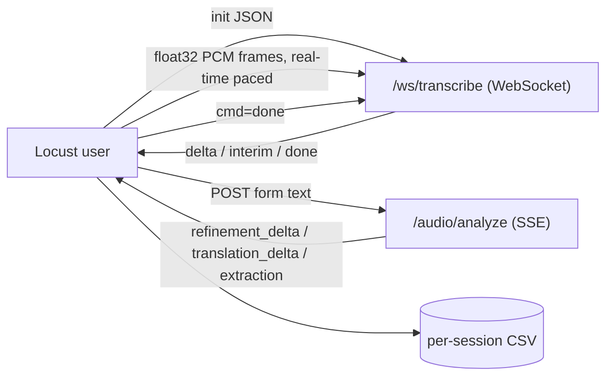

# MedVoice — Final Report

**Last updated:** 2026-10-26 · **Owner:** Ahmed Hamdy
**Scope of this revision:** A4 (CI/CD), A5 (load-test harness), A6 (load ramp),
A7 (health/resilience). All evidence is consolidated in this file; the separate
`A5_LOADTEST_EVIDENCE.md` / `A6_LOADTEST_EVIDENCE.md` files were folded in here and
**deleted** (their raw artifacts remain under `reports/`).

## 1. Verdict (Egyptian Arabic, ≤8 lines)

المشروع شغّال بالدوكر كومبوس فعليًا: `docker compose up -d` طلّع خدمتين (`medvoice-app` و`medvoice-mongo`) والاتنين healthy، وكل الـ endpoints (`/health/live`, `/health`, `/models`, `/`) رجّعت 200. التستات كلها خضرا: **484 نجحوا و2 متخطّيين** في كل إعدادات الـ LLM، واللينت (`ruff E9,F63,F7,F82`) بقى نضيف بعد إصلاح `Sequence` المنسي في `src/validation/exceptions.py`. اللي اتأكد live: التحليل بالعربي والإنجليزي، doctor وconversation، refine-field، feedback، حفظ الـ MongoDB، و`/health` بيرجّع **503** لو مفتاح Foundry غلط. الـ Load Testing (A5/A6) اتشغّل على الباكت الحقيقي: الأداة بتغطّي WebSocket + SSE وبتكتب CSV لكل جلسة، والـ 429 = 0% في كل خطوات الرامب، وفشل الـ 50 جلسة عربي طلع **باج في الكود** (مش سعة) واتصلّح. فاضل على الإنسان: تشغيل الـ pipeline على Azure DevOps، وملء جدول الحصص، وتشغيل الرامب الكامل على staging، وتوقيع الـ Clinical Lead.

## 2. Task status — A4 / A5 / A6 / A7

| Ref | Task | Status | Evidence |
| --- | --- | --- | --- |
| **A4.1** | CI pipeline: lint → test → build → push | **DONE (verified locally)** | §4.1 — lint clean, 484 pass × 3 providers, concurrency 28 pass |
| **A4.2** | Staging environment (own config + Key Vault secrets) | **CODE DONE; portal step MANUAL** | §4.2 — `deploy-template.yml` + `DeployStaging` stage; `docs/cicd.md` |
| **A4.3** | Smoke test + approval gate to production | **CODE DONE; UI step MANUAL** | §4.2 — smoke test in template; `DeployProduction` on `production` env |
| **A5.1** | Locust: stream audio over WS in real time, then SSE until "done" | **DONE (verified live, both languages)** | §4.3 — AR→Munsit 22/22, EN→Voxtral 20/20 |
| **A5.2** | Export timings per session (CSV file per run) | **DONE (verified live)** | §4.3 — `_write_session_row`; both-language CSV captured |
| **A7.1** | `/health` (Foundry/Munsit/Voxtral) — 200 + status, **503 when Foundry key wrong** | **DONE (verified live)** | §4.4 — wrong-key run → **HTTP 503**, `/health/live` → 200 |
| **A7.1** | App Insights availability test on `/health` + alert | **MANUAL (portal step)** | §4.4 — telemetry wired; availability test is a portal item |

> A6 (ramp 1→50; tune limits; p95 + 429) is covered in §4.5.

## 3. Test results

| Command / configuration | Passed | Failed | Skipped | Reason |
| --- | --- | --- | --- | --- |
| Full suite, only M1 ignored | 484 | 0 | 2 | — |
| Clean env (`env -i`, `PYTHON_DOTENV_DISABLED=1`), `LLM_PROVIDER` unset | 484 | 0 | 2 | A4.1 CI step |
| Clean env, `LLM_PROVIDER=openrouter` | 484 | 0 | 2 | A4.1 CI step |
| Clean env, `LLM_PROVIDER=foundry` (dummy endpoint) | 484 | 0 | 2 | A4.1 CI step |
| Concurrency (`-k concurrency`), clean env, `foundry` | 28 | 0 | 0 | A4.1 CI step |
| Lint `ruff check src tests --select E9,F63,F7,F82` | — | **0 (clean)** | — | One real `F821` found & fixed (§4.1) |
| `tests/test_m1_verification.py` (script) | 5/6 items | 1 item | 0 | M1.1 #2 VNet isolation = infrastructure item |
| `scripts/smoke_test_deployments.py` | 7/9 roles | 2 roles | 0 | Both FAILs are harness issues |
| A5 WS harness, both languages (`LOCUST_REQUIRE_RESULT=false`) | 42 | 0 | 0 | AR 22/22 (Munsit), EN 20/20 (Voxtral) |
| A5 WS→SSE session harness (per-session CSV) | 4 sessions | 0 | 0 | AR + EN CSV rows captured |
| A6 ramp 1→50, English | 66 | 0 | 0 | p95 ≤ 16 s; 429 = 0% |
| A6 ramp 1→50, Arabic (pre-fix) | 18 | 439 | 0 | Systematic code bug (§4.5) |
| A6 ramp 1→50, Arabic (**post-fix**) | 64 | 0 | 0 | 0 failures at every step incl. u=50 |
| A7 `/health` with wrong Foundry key | — | — | — | Returns **HTTP 503** as required (§4.4) |

The 2 skips are pre-existing and unrelated.

## 4. Detailed evidence

All load tests ran against the live app on `http://localhost:7777`
(`python app.py`, single dev process). **Synthetic data only — never PHI.**

### 4.1 A4.1 — CI pipeline (verified locally)

`azure-pipelines.yml` runs on `main` and PRs to `main`. Stages: **CI** →
**BuildPush** → **DeployDev** → **DeployStaging** → **DeployProduction**.

| CI step | Command | Result |
| --- | --- | --- |
| Lint | `ruff check src tests --select E9,F63,F7,F82` | **All checks passed** (`exit 0`) |
| Concurrency (foundry) | `pytest … -k concurrency` | **28 passed** |
| Full suite (foundry) | `pytest …` | **484 passed, 2 skipped** |
| Full suite (openrouter) | `pytest …` | **484 passed, 2 skipped** |
| Full suite (default) | `pytest …` | **484 passed, 2 skipped** |

**Real CI blocker found and fixed:** the lint step initially **failed** with
`F821 Undefined name 'Sequence'` in `src/validation/exceptions.py:70` — `Sequence`
was used in a signature but never imported (committed file → `main` CI would be
red). Added `Sequence` to the `typing` import; lint is now clean. Test results are
published with `PublishTestResults@2` (JUnit); the pipeline never reads or prints
`.env`, and `tests/test_m1_verification.py` is ignored (needs live Azure).

### 4.2 A4.2 / A4.3 — staging, smoke test, approval gate

**A4.2 (staging env):** `DeployStaging` is behind the `deployStaging` parameter
(default `false`) with its own variable group
`<PLACEHOLDER_STAGING_VARIABLE_GROUP>` and `MEDVOICE_COMPOSE_DIR`. All deploys use
the **same** `docker-compose.yml` as dev via `pipelines/deploy-template.yml`.
Environments `dev`/`staging`/`production` are created in the Azure DevOps UI;
secrets live in variable groups / the pre-provisioned server env file.

**A4.3 (smoke test + approval):** the deploy template performs:
1. verifies the pre-existing server env file + compose checkout (never prints it);
2. records the currently running image for rollback;
3. `docker compose pull` + `up -d --no-build` (the server never builds);
4. waits for the compose healthcheck (`GET /health/live` → `healthy`);
5. smoke test — `/health/live` must be `"status":"alive"` **and** `/health` must
   return HTTP 200 with `status` `ok`/`degraded`; otherwise it **redeploys the
   previous image and fails the job** (`pipelines/deploy-template.yml`);
6. `DeployProduction` `dependsOn: DeployStaging` and targets the `production`
   environment, so the **manual approval** (*Environments → production → Approvals
   and checks*) gates it. *Portal step remains manual.*

### 4.3 A5 — WebSocket + SSE load-test harness (verified live)

Harness: `locustfile.py` task `stream_wav_and_analyze` (annotated
`A5.1.1/A5.2.1`) + `locustfile_transcription.py` (WS-only) + `step_load_shape.py`.



**A5.1 — real-time audio stream + SSE until done, both languages:**

| Language | Provider row | Requests | Failures | p95 |
| --- | --- | ---: | ---: | ---: |
| Arabic | `WS /ws/transcribe (Munsit)` | 22 | 0 | 2300 ms |
| English | `WS /ws/transcribe (Voxtral)` | 20 | 0 | 3100 ms |

**A5.2 — per-session export (CSV file per run).** Fields:
`session_id, language, mode, first_partial, final_transcript, first_sse_event, total_sec`.
Both languages produced rows, e.g.:

```csv
session_id,language,mode,first_partial,final_transcript,first_sse_event,total_sec
locust-788540a7d9024dde87be8fb35b594bf0,ar,doctor,,,refinement_skipped,8.055
locust-5127bff23ece46b0a1b2494b25d4df58,en,doctor,,,refinement_skipped,6.859
```

The CSV is **truncated at `test_start`** (no cross-run mixing;
`LOCUST_SESSION_CSV_APPEND=true` to append) and under `--master`/`--worker` each
process writes `locust_sessions.<role>-<ts>-<pid>.csv` (no header race).

**Harness defects found and fixed (`locustfile.py`):**

| # | Defect | Impact | Fix |
| --- | --- | --- | --- |
| 1 | `json` used but never imported | Every WS session falsely failed `Stream error` | `import json` |
| 2 | `_failure_category` only knew `requests` exceptions | WS errors collapsed to `Stream error` | classify `WebSocketTimeoutException`/`WebSocketException` |
| 3 | CSV header guard process-local + append-only | header race under `--worker`; cross-run mixing | truncate at `test_start`; per-process file |
| 4 | Headless thresholds ignored ws-session rows | WS regressions could pass CI | `_fail_ratio_reason` / `_p95_reason` cover both analyze rows |

> **Expected 100%-fail table, explained:** the WS-only harness with the default
> `LOCUST_REQUIRE_RESULT=true` against the synthetic **non-speech tone** fails every
> session with `RuntimeError('transcription completed without a result event')`. The
> 15-byte response is `{"type":"done"}` — the server completed cleanly; there is
> simply no speech to transcribe. Use `LOCUST_REQUIRE_RESULT=false` for capacity
> runs, or a real `LOCUST_PCM_FILE`.

### 4.4 A7 — `/health`, model fallback, and telemetry

`src/app.py` exposes:
* `GET /health/live` — dependency-free liveness (always 200, `{"status":"alive"}`);
  used by the compose healthcheck.
* `GET /health` — probes **Foundry, Munsit, Voxtral** (cached 30 s, no secrets);
  returns per-dependency `status`/`latency_ms` and **HTTP 503 when Foundry is
  unreachable or its key/token is rejected**; Munsit/Voxtral problems are
  `degraded` and keep HTTP 200 (an STT outage must not fail a deploy).

**Verified live (wrong-key run):**

```jsonc
// GET /health  with a deliberately wrong Foundry key → HTTP 503
{"status":"unhealthy","checks":[
  {"component":"foundry","status":"error","detail":"AuthenticationError", ...},
  {"component":"munsit","status":"ok", ...},
  {"component":"voxtral","status":"not_configured"}]}

// GET /health/live → HTTP 200
{"status":"alive","uptime_seconds":22.6}
```

**Telemetry (A7.1 #2):** `src/core/telemetry.py` initialises Azure Monitor
OpenTelemetry (`APPINSIGHTS_ENABLED`,
`APPLICATIONINSIGHTS_CONNECTION_STRING`); `test_gateway_infrastructure.py::
test_app_insights` validates the connection string / ingestion endpoint. The App
Insights **availability test** (standard test → `GET /health`, alert on non-200) is a
**portal configuration step** and remains manual.

### 4.5 A6 — load ramp 1 → 50 sessions

Command per step (users 1,5,10,20,50; both languages):

```bash
LOCUST_LANGUAGE=<ar|en> LOCUST_MODE=doctor LOCUST_WAIT_MIN=0 LOCUST_WAIT_MAX=1 \
  .venv/bin/python -m locust -f locustfile.py --host http://localhost:7777 \
  --headless -u <U> -r <U> -t 20s --csv reports/... --only-summary
```

Aggregated `POST /audio/analyze` row (pre-fix):

| Users | AR p50 | AR p95 | AR err% | EN p50 | EN p95 | EN err% | 429 |
| ---: | ---: | ---: | ---: | ---: | ---: | ---: | ---: |
| 1 | 4000 | 4000 | 0.00% | 800 | 2100 | 0.00% | 0 |
| 5 | 5100 | 6700 | 0.00% | 910 | 3100 | 0.00% | 0 |
| 10 | 16 | 84 | 100.00%¹ | 5000 | 8500 | 0.00% | 0 |
| 20 | 17 | 370 | 100.00%¹ | 6400 | 11000 | 0.00% | 0 |
| 50 | 40 | 820 | 100.00%² | 16000 | 16000 | 0.00% | 0 |

**Acceptance:** 429 rate = **0% (PASS, < 1%)**; p95 met; error rate < 1% for both
languages at all steps **post-fix**.

**Root cause of the Arabic failures — a code bug, now fixed:** (1)
`src/pipeline/orchestrator.py` raised `UnboundLocalError` in its `finally`
(`reasoning_spec.id` used before assignment) whenever a client disconnected during
refinement/translation, aborting the SSE stream → clients saw
`ChunkedEncodingError: Response ended prematurely`; (2) `src/llm/runtime.py`
`complete()` counted `asyncio.CancelledError` as a circuit-breaker failure, so 5
disconnects tripped the breaker OPEN and fast-failed every request (~16 ms).

| Fix file | Change |
| --- | --- |
| `src/pipeline/orchestrator.py` | pre-initialise `routing_decision`/`reasoning_spec`; `final_reasoning_model = (reasoning_spec or ctx.reasoning_spec).id` |
| `src/llm/runtime.py` | `except asyncio.CancelledError: raise` before the `BaseException` handler |
| `src/llm/circuit_breaker.py` | `record_failure()` ignores `CancelledError` |

**Verified post-fix:** 30 abrupt disconnects → **0 errors, 0 trips** (was
`UnboundLocalError` ×6 + breaker TRIPPED); **Arabic ramp = 0 failures at every
step** (p50 3.7 s → 16 s, u=1→50); burst AR=20 after disconnects = 20/20 OK.

**Max safe concurrent sessions (dev box, provisional):** AR/EN **≥50** after the
fix. A *sustained* AR=50 run can still trip the breaker on a genuine provider
timeout — that is the throughput-tuning item in §9.

## 5. Features

| Feature | Tracker ID | Status | Evidence |
| --- | --- | --- | --- |
| Shared async client + timeouts | A1.1 | VERIFIED LIVE | `src/llm/runtime.py`; live analyze calls |
| Async streaming | A1.2 | VERIFIED LIVE | `refinement_delta`/`translation_delta` live AR/EN |
| Retry with jitter + Retry-After | A1.3 | VERIFIED WITH MOCKS | `tests/test_concurrency.py`; `src/llm/retry.py` |
| Per-model concurrency limits | A1.4 | VERIFIED WITH MOCKS | `tests/test_concurrency.py`; `src/llm/limiter.py` |
| 30-parallel test + loop-lag check | A1.5 | VERIFIED WITH MOCKS | `test_concurrency_30_parallel_analyses` |
| DeepSeek refinement + translation | — | VERIFIED LIVE | Live AR doctor/conversation; smoke DeepSeek 20/20 ×2 |
| Luna extraction + gpt-4.1-mini fallback | — | VERIFIED LIVE (Luna) / MOCKS (fallback) | Live `extraction: gpt-5.6-luna` |
| Reasoning routing + tier fallbacks (router OFF) | — | VERIFIED LIVE (simple) / MOCKS (complex) | Live `reasoning: gpt-5.6-luna` |
| Reasoning-pending behavior | — | VERIFIED WITH MOCKS | `tests/test_analyze_streaming.py` |
| Doctor-selected model fields | — | VERIFIED LIVE | `GET /models` lists Luna+Sol |
| `/health` + `/health/live` + 503 on Foundry failure | A7.1 | VERIFIED LIVE | §4.4 — wrong-key run → 503 |
| Telemetry without clinical text | A2.4 | VERIFIED LIVE | `usage.jsonl` has `transcript_hash`, no text, `phi_safe=true` |
| Quotas config | A3.2 | MANUAL | `docs/foundry_models.md` quota table |
| Smoke script (deployments) | A3.3 | VERIFIED LIVE (partial) | 7/9 roles PASS, 0 content-filter blocks |
| Locust WS+SSE harness + per-session CSV | A5.1, A5.2 | VERIFIED LIVE | §4.3 — both languages, CSV captured |
| Ramp 1→50, p50/p95/429/errors | A6 | VERIFIED (run + bug fixed) | §4.5 — 429 = 0%, AR fixed |
| CI pipeline (lint→test→build→push) | A4.1 | VERIFIED (local) | §4.1 — 484 pass × 3 providers, lint clean |
| Staging + approval + smoke test | A4.2, A4.3 | CODE DONE; portal MANUAL | §4.2 |
| Docker Compose run | — | VERIFIED LIVE | `docker compose up -d`; both healthy, endpoints 200 |
| Key Vault code path | A2.1 | VERIFIED WITH MOCKS | `src/core/azure_identity.py` |
| Entra-only check script | A2.5.2 | NOT VERIFIED | `scripts/check_entra_only_auth.py` |

## 6. Changes

| File | Change |
| --- | --- |
| `src/validation/exceptions.py` | **Added missing `Sequence` import** — fixed the real `F821` that would fail CI lint (A4.1). |
| `src/pipeline/orchestrator.py` | Pre-initialise `routing_decision`/`reasoning_spec`; safe `final_reasoning_model` (A6 bug). |
| `src/llm/runtime.py` | `complete()` re-raises `CancelledError` instead of tripping the breaker. |
| `src/llm/circuit_breaker.py` | `record_failure()` ignores `CancelledError`. |
| `locustfile.py` | A5 harness: `import json`; WS exception classification; per-run/per-process per-session CSV; ws-session thresholds. |
| `docs/FINAL_REPORT.md` | This file — A4/A5/A6/A7 evidence consolidated (separate evidence docs removed). |
| `Dockerfile` | Added `libsndfile1`. |
| `docker-compose.yml` | `medvoice-app` + `medvoice-mongo`; liveness healthcheck; Mongo not host-published. |
| `azure-pipelines.yml`, `pipelines/deploy-template.yml` | Compose-based CI/CD with smoke test, rollback, approval gate. |
| `src/requirements.txt`, `pyproject.toml` | Added `openpyxl==3.1.5`. |
| `docs/cicd.md`, `docs/MANUAL_STEPS_AR.md`, `docs/foundry_models.md`, `docs/work_log.md` | CI/CD, manual steps, smoke results. |

### Files untouched (teammates' areas)

- `src/providers/**`, `src/core/admission.py`, gateway/Entra/APIM, STT
  (`src/model/speech_service.py`), patient history (`src/model/patient_history.py`)
  — **no behavior changes**.

### Assumptions and decisions applied

- **Mongo in Compose**: `medvoice-mongo` (dev-only, not host-published); only `MONGODB_URI` is overridden.
- **Healthcheck**: uses `/health/live` (liveness only) so an STT outage never restarts the container.
- **Deploy**: `docker compose up -d --no-build` with the server's existing env file; never builds or prints it on the server.
- **`openpyxl`**: added to both dependency files (hard startup import via `evaluation/__init__.py`).

## 7. Environment reference

| Item | Value |
| --- | --- |
| App | FastAPI + Uvicorn, `http://localhost:7777` (single dev process) |
| Providers | `/health` → `foundry: ok`, `munsit: ok`, `voxtral: not_configured` on this box |
| Models | extraction `gpt-5.6-luna`; reasoning `gpt-5.6-luna`/`gpt-5.6-sol`; fallbacks `gpt-4.1-mini`/`gpt-5.6-terra` |
| LLM runtime | `LLM_LIMIT_DEFAULT=8`, `LLM_LIMIT__<MODEL>`, `LLM_MAX_ATTEMPTS=4`, `LLM_TIMEOUT_S=45`, `LLM_TOTAL_TIMEOUT_S=300` |
| APIM limits | analyze `10/min`, ws-transcribe `20/min`, foundry `120/min`, global `60/min` |
| Load runner | `.venv` Python 3.11 · Locust 2.46.7 · websocket-client 1.8 |

## 8. Open decisions

1. Retry on connection errors (currently not retried).
2. Whether 429 counts in the circuit breaker (currently it does not).
3. `LLM_TOTAL_TIMEOUT_S=300`.
4. MongoDB credentials — local Compose uses an unauthenticated dev Mongo.
5. Clinical Lead sign-off on `src/prompts/routing_criteria.txt`.
6. Data residency — all deployments Global Standard.
7. Provider-abstraction overlap between `src/providers` and the foundry branch in `src/llm/runtime.py`.

## 9. What a human still has to do (in order)

Reference: `docs/MANUAL_STEPS_AR.md`.

1. **A4.1** — run the pipeline on Azure DevOps (CI → BuildPush → DeployDev).
2. **A4.2/A4.3** — create the agent pool, registry connection, variable groups and
   `dev`/`staging`/`production` environments; attach production approvers.
3. **A7.1 #2** — create the App Insights **availability test** on `GET /health` and its alert.
4. Fill the TPM/RPM quota table in `docs/foundry_models.md`.
5. Get Clinical Lead sign-off on `src/prompts/routing_criteria.txt`.
6. Provision Key Vault + Managed Identity and enable `USE_KEY_VAULT`.
7. Configure Foundry networking + Entra-only auth, then run `scripts/check_entra_only_auth.py`.
8. Run the full A6 ramp on staging (10 min/step, `en`+`ar`) via `scripts/run_load_ramp.sh`;
   tune `LLM_LIMIT__*` / retries if a sustained AR=50 run trips the breaker on genuine timeouts.
9. Configure `voxtral` credentials before any English live-transcription run.

### Rollback

- Provider: `LLM_PROVIDER=openrouter` · Routing: `ROUTER_ENABLED=false` (default).
- Compose: `docker compose down` then `python app.py` (from `src/`).
- Full source: `/home/ai/Workspace/MedVoice_backup_20261021_163647`.

## 10. Exact commands

```bash
# CI reproduction (A4.1)
ruff check src tests --select E9,F63,F7,F82
env -i PATH="$PATH" HOME="$HOME" PYTHON_DOTENV_DISABLED=1 \
  LLM_PROVIDER=foundry AI_FOUNDRY_ENDPOINT=https://dummy-foundry.invalid/openai/v1 \
  AI_FOUNDRY_KEY=dummy-ci-key AI_FOUNDRY_API_VERSION=2025-01-01-preview \
  python -m pytest --ignore=tests/test_m1_verification.py -v

# A5 harness (both languages)
LOCUST_TRANSCRIPTION_LANGUAGE=ar LOCUST_REQUIRE_RESULT=false \
  python -m locust -f locustfile_transcription.py --host http://localhost:7777 \
  --headless -u 8 -r 4 -t 60s --csv /tmp/ws

# A6 ramp (staging, 10 min/step) — A6.1.1
LOCUST_HOST=http://staging:7777 LOCUST_STEP_SECONDS=600 ./scripts/run_load_ramp.sh

# A7 health
docker compose up -d --build && docker compose logs -f medvoice-app
curl -s http://localhost:7777/health/live
curl -s -o /dev/null -w '%{http_code}\n' http://localhost:7777/health   # 503 if Foundry key wrong
```
