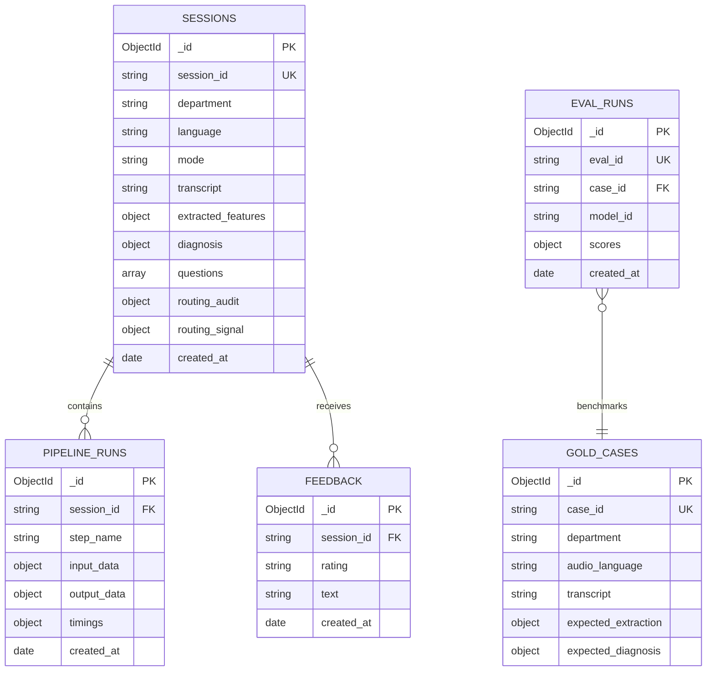

# MedVoice MongoDB Database Specification & Live Record Example

This document provides the complete architectural schema design, collection specifications, indexes, and a full JSON example of the most recent successful record inserted into the live database.

---

## 1. Database Architecture & Collections Overview

* **Database Name:** `medvoice`
* **Driver:** `motor` (AsyncIOMotorClient) + `pymongo`
* **Access Strategy:** Primary persistence layer with dual-write JSONL fallback (`usage.jsonl` / `feedback.jsonl`).



---

## 2. Complete Collection Schemas & Index Definitions

### 2.1 Collection: `sessions`
Stores the complete clinical encounter lifecycle, including transcribed text, extracted features, generated questions, differential diagnosis, and LLM telemetry.

| Field Name | Type | Description |
| :--- | :--- | :--- |
| `_id` | `ObjectId` | Auto-generated MongoDB primary key. |
| `session_id` | `string` | Unique UUID v4 for the session. |
| `created_at` | `ISODate` | Encounter creation timestamp (UTC). |
| `updated_at` | `ISODate` | Last update timestamp (UTC). |
| `department` | `string` | Department enum (`er`, `opd`, `dental`). |
| `mode` | `string` | Interaction mode (`doctor` dictation vs `conversation`). |
| `language` | `string` | Primary audio language (`ar` or `en`). |
| `specialty` | `string` (nullable) | Clinical sub-specialty (e.g. `cardiology`). |
| `clinician_name` | `string` (nullable) | Name of attending physician (from SSO/request). |
| `sso_user` | `string` (nullable) | Authenticated Entra ID user identity. |
| `patient_id` | `string` (nullable) | Patient hospital MRN/ID. |
| `business_unit` | `string` (nullable) | Hospital facility / BU identifier. |
| `status` | `string` | Pipeline execution status (`complete`, `error`, `degraded`). |
| `transcript` | `string` | Verbatim text returned by STT engine (Munsit/Voxtral). |
| `refined_text` | `string` | Clinical entity-refined transcript text. |
| `translated_text` | `string` | English translation (if source was Arabic). |
| `transcript_hash` | `string` | SHA-256 integrity hash of original transcript. |
| `extracted_features`| `object` | Medical feature schema (Chief complaint, HPI, allergies, plan, etc.). |
| `diagnosis` | `object` | ICD-10 codes, reasoning chain, differentials, laterality check. |
| `questions` | `array[object]`| Clinical follow-up questions for missing fields. |
| `routing_signal` | `object` | Acuity red-flag triggers and urgency level (CTAS). |
| `routing_audit` | `object` | LLM router decision metadata and fallback tracking. |
| `extraction_usage`| `object` | Tokens, latency, deployment name (`gpt-5.6-luna`), and cost. |
| `diagnosis_usage` | `object` | Tokens and latency for the diagnostic reasoning model. |
| `timings` | `floats` | Per-step latencies: `transcription_sec`, `extraction_sec`, etc. |

**Indexes on `sessions`:**
* `{ "session_id": 1 }` (Unique, Sparse)
* `{ "created_at": 1 }`
* `{ "department": 1 }`
* `{ "clinician_name": 1 }`
* `{ "department": 1, "created_at": -1 }` (Compound query index)

---

### 2.2 Collection: `feedback`
Captures clinician rating (thumbs up/down), error reports, and client telemetry events.

| Field Name | Type | Description |
| :--- | :--- | :--- |
| `_id` | `ObjectId` | MongoDB primary key. |
| `session_id` | `string` | Reference to encounter `session_id` or `anonymous-session`. |
| `rating` | `string` (nullable) | `up`, `down`, or star rating. |
| `text` | `string` | Clinician comments or UI telemetry payload. |
| `name` | `string` (nullable) | Submitter name. |
| `department` | `string` (nullable) | Active clinical department. |
| `language` | `string` (nullable) | Active interface language. |
| `ip` | `string` | Client IP address. |
| `created_at` | `ISODate` | Timestamp of submission. |

**Indexes on `feedback`:**
* `{ "session_id": 1 }`
* `{ "created_at": 1 }`
* `{ "department": 1, "created_at": -1 }`

---

### 2.3 Collection: `pipeline_runs`
Fine-grained audit trail logging input/output for each pipeline step (e.g., STT, Refine, Extract, Reason, Translate).

| Field Name | Type | Description |
| :--- | :--- | :--- |
| `_id` | `ObjectId` | MongoDB primary key. |
| `session_id` | `string` | Encounter session ID. |
| `step_name` | `string` | Step name (`extraction`, `diagnosis`, `question_generation`). |
| `input_data` | `object` | Payload passed into step. |
| `output_data` | `object` | Step output payload. |
| `timings` | `object` | Execution latency breakdown. |
| `created_at` | `ISODate` | Timestamp with automatic **90-day TTL expiration**. |

**Indexes on `pipeline_runs`:**
* `{ "session_id": 1 }`
* `{ "session_id": 1, "step_name": 1 }`
* `{ "created_at": 1 }` (TTL: `expireAfterSeconds = 7776000`)

---

### 2.4 Collection: `gold_cases` & `eval_runs`
Supports the evaluation engine (M3/M8) by storing reference cases and benchmark score runs.

* **`gold_cases` Indexes:**
  * `{ "case_id": 1 }` (Unique)
  * `{ "department": 1, "specialty": 1 }`
* **`eval_runs` Indexes:**
  * `{ "eval_id": 1 }` (Unique)
  * `{ "case_id": 1, "model_id": 1 }`
  * `{ "session_id": 1 }`

---

## 3. Example of Last Successful Inserted Session

Below is the verbatim JSON document retrieved directly from the live `sessions` collection for session `725e0f8e-04d3-4ce4-b62c-b09f999191d6`:

```json
{
  "_id": {
    "$oid": "6ae05178077b7d1542c11df4"
  },
  "session_id": "725e0f8e-04d3-4ce4-b62c-b09f999191d6",
  "created_at": {
    "$date": "2026-10-27T07:23:36.962Z"
  },
  "updated_at": {
    "$date": "2026-10-27T07:23:36.962Z"
  },
  "department": "opd",
  "mode": "doctor",
  "language": "en",
  "status": "error",
  "total_sec": 45.023,
  "transcription_sec": 12.33,
  "refinement_sec": 0.0,
  "translation_sec": 0.0,
  "extraction_sec": 6.663,
  "question_generation_sec": 0.001,
  "diagnosis_sec": null,
  "transcript": "The patient has been complaining from bilateral pain since five years ago and he is now undergoing physical exercises and will be reassessed after two weeks.",
  "refined_text": "The patient has been complaining from bilateral pain since five years ago and he is now undergoing physical exercises and will be reassessed after two weeks.",
  "translated_text": "The patient has been complaining from bilateral pain since five years ago and he is now undergoing physical exercises and will be reassessed after two weeks.",
  "transcript_hash": "9bbc09004123e2548038ab02ac03676317202e671532674b8a5d74ba3081423f",
  "ip": "172.23.0.1",
  "user_agent": "Mozilla/5.0 (Windows NT 10.0; Win64; x64) AppleWebKit/537.36 (KHTML, like Gecko) Chrome/155.0.0.0 Safari/537.36 Edg/155.0.0.0",
  "extracted_features": {
    "chief_complaint": "Bilateral pain",
    "onset": "Started five years ago",
    "course": null,
    "duration": "Five years",
    "comorbidities": null,
    "medication_history": null,
    "past_medical_history": null,
    "past_surgical_history": null,
    "social_family_history": null,
    "examination_finding": null,
    "plan_of_care": "Continue physical exercises and reassess after two weeks",
    "procedures_planned": null,
    "referrals": null,
    "follow_up_timing": "After two weeks",
    "patient_instructions": null,
    "allergy_status": null,
    "outcome_progress_status": null
  },
  "extraction_usage": {
    "model_id": "gpt-5.6-luna",
    "foundry_deployment": "gpt-5.6-luna",
    "latency_sec": 6.648,
    "prompt_tokens": 932,
    "completion_tokens": 311,
    "reasoning_tokens": 108,
    "cost_usd": null,
    "reasoning_enabled": false,
    "error": null,
    "served_deployment": "gpt-5.6-luna",
    "fallback_used": false
  },
  "diagnosis": {
    "icd10_codes": [],
    "icd10_unmatched": [],
    "reasoning": "",
    "final_diagnosis": null,
    "history_considered": "No",
    "history_notes": "",
    "history_citation_missing": false,
    "history_cited_visit_dates": [],
    "differential_diagnoses": null,
    "differential_unmatched": null,
    "triage_priority": null
  },
  "questions": [
    {
      "question": "What is the patient's allergy status (or NKDA)?",
      "answer": null,
      "needs_asking": true,
      "category": "Allergy Status"
    },
    {
      "question": "How has the condition progressed (course)?",
      "answer": null,
      "needs_asking": true,
      "category": "Course"
    },
    {
      "question": "Does the patient have any comorbidities?",
      "answer": null,
      "needs_asking": true,
      "category": "Comorbidities"
    },
    {
      "question": "What medications is the patient currently taking?",
      "answer": null,
      "needs_asking": true,
      "category": "Medication History"
    },
    {
      "question": "What is the patient's past medical history?",
      "answer": null,
      "needs_asking": true,
      "category": "Past Medical History"
    },
    {
      "question": "What is the patient's past surgical history?",
      "answer": null,
      "needs_asking": true,
      "category": "Past Surgical History"
    },
    {
      "question": "What is the patient's social, marital, or family history?",
      "answer": null,
      "needs_asking": true,
      "category": "Social / Marital / Family History"
    },
    {
      "question": "What were the examination findings?",
      "answer": null,
      "needs_asking": true,
      "category": "Examination Finding"
    },
    {
      "question": "Are any procedures planned?",
      "answer": null,
      "needs_asking": true,
      "category": "Procedures Planned"
    },
    {
      "question": "Were any referrals made?",
      "answer": null,
      "needs_asking": true,
      "category": "Referrals"
    },
    {
      "question": "What instructions were given to the patient?",
      "answer": null,
      "needs_asking": true,
      "category": "Patient Instructions"
    },
    {
      "question": "If this is a follow-up visit, what is the outcome/progress status?",
      "answer": null,
      "needs_asking": true,
      "category": "Outcome / Progress Status"
    }
  ],
  "routing_signal": {
    "requires_clinician_review": false,
    "highest_acuity": null,
    "action": "none_detected",
    "matched_signals": [],
    "notice": "No lexicon phrase matched. This does not rule out an urgent condition."
  },
  "routing_audit": {
    "complexity": "simple",
    "reason_codes": [],
    "router_deployment": "",
    "tier": "simple",
    "served_deployment": "gpt-5.6-luna",
    "fallback_used": false,
    "router_ok": false,
    "router_latency_sec": null,
    "attempts": 0
  }
}
```

---

## 4. Example of Last Successful Feedback Record

Below is the matching telemetry document from the `feedback` collection:

```json
{
  "_id": {
    "$oid": "6ae051788be7a5e8b2e24773"
  },
  "session_id": "anonymous-session",
  "created_at": {
    "$date": "2026-10-27T07:23:36.985Z"
  },
  "department": "opd",
  "language": "en",
  "ip": "172.23.0.1",
  "name": null,
  "sso_user": null,
  "rating": null,
  "text": "[Telemetry:cautions_rendered] {\"cautions_count\":0,\"classified_count\":0,\"tier\":\"primary\",\"is_valid\":true}"
}
```
