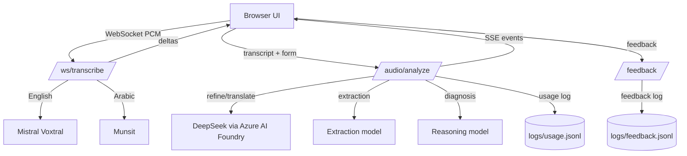
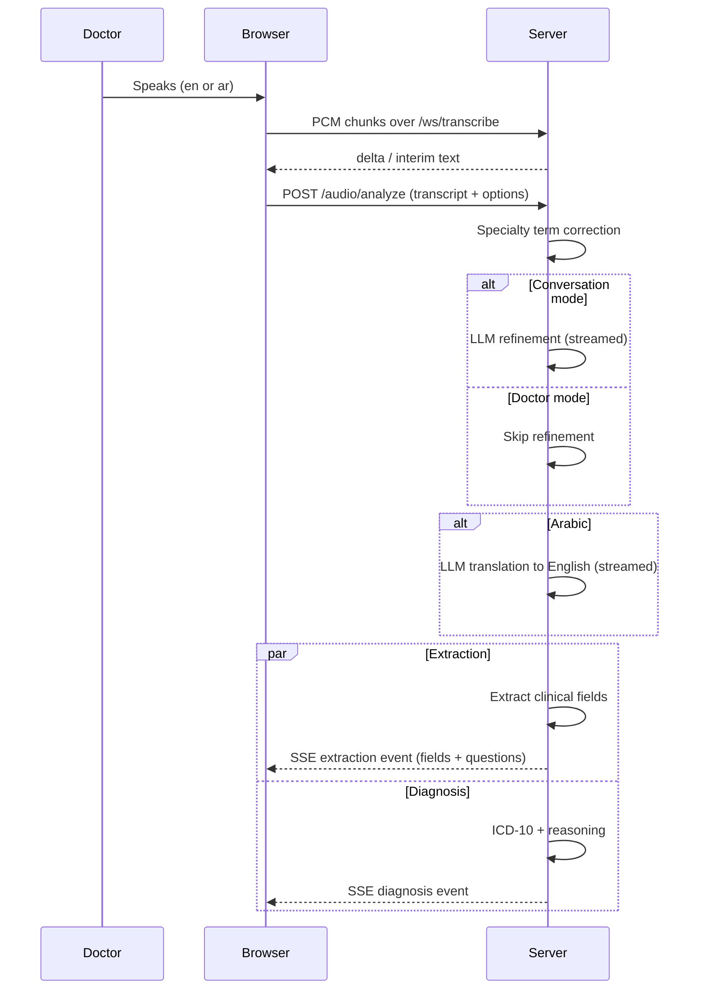

# MedVoice — Project Documentation

MedVoice is a clinical voice assistant that turns a doctor's dictation or a
doctor–patient conversation into a structured clinical note. It transcribes
live audio, refines and translates the transcript, extracts structured
clinical fields, recommends ICD-10 diagnoses with reasoning, and streams every
step to the browser in real time.

---

## Table of Contents

1. [Architecture Overview](#architecture-overview)
2. [Pipeline](#pipeline)
3. [Project Structure](#project-structure)
4. [Configuration](#configuration)
5. [Installation and Running](#installation-and-running)
6. [API Reference](#api-reference)
7. [WebSocket Transcription Protocol](#websocket-transcription-protocol)
8. [SSE Event Reference](#sse-event-reference)
9. [Model Registry](#model-registry)
10. [LLM Concurrency Runtime](#llm-concurrency-runtime)
11. [Load Testing](#load-testing)
12. [Model Evaluation](#model-evaluation)
13. [Testing](#testing)
14. [Logging and Dashboard](#logging-and-dashboard)
15. [Security Notes](#security-notes)

---

## Architecture Overview



Key design points:

- **One FastAPI application** (`src/app.py`) serves the UI, the REST API,
  the WebSocket transcription endpoint, and the analytics dashboard.
- **One shared LLM runtime per worker** owns a single `AsyncOpenAI` client,
  one HTTP connection pool, and per-model semaphores. Requests never build
  their own clients.
- **Streaming everywhere**: transcription streams over WebSocket, analysis
  streams over SSE, so the doctor sees results as each step finishes.
- **Extraction and diagnosis run in parallel**. Separate SSE events are sent
  as each step finishes, so the browser can display the first result without
  waiting for the slower step.

---

## Pipeline



Stages:

1. **Transcription** — English via Mistral Voxtral realtime; Arabic via
   Munsit (dialect-aware, including Khaliji/Gulf).
2. **Refinement** — LLM cleanup of the raw transcript. Skipped in doctor
   mode; streamed in conversation mode.
3. **Translation** — Arabic to English, streamed. Skipped for English.
4. **Extraction** — structured clinical-note fields for the selected
   department (ER, OPD, or Dental). After extraction, a live required-fields
   notice lists the department's mandatory note fields that are still empty:
   ER requires chief complaint, past medical and surgical history, medication
   history, examination, and plan of care; OPD requires chief complaint, past
   medical and surgical history, medication history, and plan of care; Dental
   requires chief complaint, past medical history, and procedure executed. The
   notice updates as the doctor types or dictates and disappears when all
   required fields are complete.
5. **Diagnosis** — ICD-10 recommendations, final diagnosis, and reasoning,
   optionally informed by patient history. When history influences the
   recommendation, the relevant prior visit date must be cited in the
   reasoning and history notes; cited dates are checked against the visits
   supplied to the model.
   A local retrieval-augmented generation (RAG) step ranks Australian
   ICD-10-AM catalogue entries using a local semantic embedding model,
   BM25-style full-note matching, and the existing phrase/code search, then
   provides a shortlist to the reasoning model. The server accepts only exact
   catalogue codes on that shortlist, canonicalizes their labels, and excludes
   other suggestions from recommendations.
6. **Questions** — generated deterministically from the extracted fields.
7. **Red-flag phrase check** — a lexicon of 169 presenting complaints
   (`src/data/red_flag_lexicon.json`), each tagged with a triage level
   (1 = most urgent … 5 = least) and an adult/pediatric/all population, checks
   the transcript, refined, and translated text. Matches are sent in an early
   `routing_signal` SSE event, repeated in the extraction event, and retained
   in the usage log and persisted session. Each match carries `acuity` and
   `population`; `highest_acuity` is the most urgent non-negated match. Where
   phrases overlap, the longest wins (e.g. "non-cardiac chest pain" does not
   also fire as cardiac chest pain). Entries with different levels per
   population (sexual assault: 3 adult / 2 pediatric) use the more urgent
   level. Common English and Arabic negation cues are labeled `negated`;
   uncertain or affirmed matches prompt clinician review. This is heuristic,
   not diagnosis or automated triage, and no match does not rule out an urgent
   condition. The phrase lists require local clinical review.

---

## ICD-10 Catalogue Retrieval (RAG)

The diagnosis step retrieves candidate code/description pairs from the
Australian ICD-10-AM catalogue loaded from the project CSV. Retrieval combines
local dense-vector semantic search (Sentence Transformers with
`abhinand/MedEmbed-small-v0.1`), BM25-style ranking over the
complete note, and the existing phrase/code search. The ranked lists are fused
before the shortlist is sent to the reasoning model. The catalogue embeddings
are cached locally by catalogue/model version and loaded into memory per
worker; clinical notes are not sent to a separate embedding service. The first
diagnosis request may take longer while the model downloads and catalogue
vectors are built.

Semantic retrieval can bridge some differences in wording, but it does not
guarantee correct coding. Validate retrieval against clinician-reviewed cases
and confirm expected codes appear in the shortlist. A server-side allow-list
ensures recommendations cannot contain codes outside that shortlist.

To download the local model and build the catalogue-vector cache before serving
clinical requests, run `PYTHONPATH=src python -m model.icd10_registry` as the
same OS user that will run MedVoice. The cache is stored under that user's
`~/.cache/medvoice/` directory.

For CPU-only installs, install CPU PyTorch before the project dependencies so
the package resolver does not pull CUDA libraries:

```bash
python -m pip install torch --index-url https://download.pytorch.org/whl/cpu
python -m pip install -r src/requirements.txt
```

---

## Project Structure

```
MedVoice/
├── src/
│   ├── app.py                    # FastAPI entrypoint: REST + WebSocket + SSE
│   ├── core/
│   │   ├── config.py             # Environment-backed configuration
│   │   └── model_registry.py     # Model slugs, defaults, judge selection
│   ├── llm/
│   │   ├── runtime.py            # Shared AsyncOpenAI runtime
│   │   ├── limiter.py            # Per-model asyncio semaphores
│   │   └── retry.py              # Bounded retry policy (429/5xx/timeouts)
│   ├── model/
│   │   ├── speech_service.py     # Voxtral + Munsit streaming transcription
│   │   ├── llm_service.py        # Refine/translate/extract/diagnose calls
│   │   ├── refine_text.py        # Synchronous refinement module
│   │   ├── translation.py       # Synchronous translation module
│   │   ├── extract_features.py   # Synchronous extraction module
│   │   ├── diagnosis.py          # Diagnosis helpers
│   │   ├── question_generator.py # Deterministic follow-up questions
│   │   ├── patient_history.py    # HCMS visit-history lookup
│   │   └── specialty_terms.py    # Fuzzy specialty-term correction
│   ├── utils/
│   │   ├── clinical_prompts.py   # Extraction/diagnosis prompts
│   │   ├── prompt.py             # Refine/translate prompts
│   │   └── metrics.py            # Metrics helpers
│   ├── static/                   # index.html + dashboard.html
│   ├── data/                     # Workbooks and visit-history CSV
│   ├── logs/                     # usage.jsonl + feedback.jsonl
│   └── uploads/                  # Uploaded recordings
├── tests/
│   ├── test_concurrency.py       # Deterministic concurrency suite
│   └── test_real_use_case_models.py # Live model evaluation + judge scoring
├── locustfile.py                 # /audio/analyze load test
├── locustfile_transcription.py   # /ws/transcribe load test
├── step_load_shape.py            # Optional stepped load shape
├── requirements-loadtest.txt     # Locust + websocket-client
├── docs/
│   ├── PROJECT_DOCUMENTATION.md  # This file
│   └── llm_concurrency_README.md # LLM runtime configuration
├── Dockerfile
├── docker-compose.yml
├── pyproject.toml
└── setup.py
```

---

## Configuration

All configuration is environment-driven via `src/core/config.py`
(`.env` is loaded automatically).
Docker Compose passes variables from `src/.env` into the container.

### Provider keys and credentials

| Variable | Purpose |
|---|---|
| `MISTRAL_API_KEY` | Voxtral English transcription |
| `MUNSIT_API_KEY` | Arabic transcription + TTS disclaimer |
| `AI_FOUNDRY_ENDPOINT` | Azure AI Foundry endpoint URL |
| `AI_FOUNDRY_KEY` | Primary API key for Azure AI Foundry |
| `AI_FOUNDRY_AUTH_METHOD` | Authentication mode (`api_key` or `managed_identity`) |
| `AI_FOUNDRY_API_VERSION` | Azure AI Foundry API version (default: `2024-06-01`) |

### LLM runtime

| Variable | Default | Purpose |
|---|---|---|
| `LLM_TIMEOUT_S` | `45` | Overall request timeout |
| `LLM_CONNECT_TIMEOUT_S` | `5` | Connect timeout |
| `LLM_MAX_ATTEMPTS` | `4` | Retry attempts including the first |
| `LLM_BACKOFF_MAX_S` | `8` | Maximum exponential backoff |
| `LLM_RETRY_AFTER_MAX_S` | `30` | Maximum honored `Retry-After` |
| `LLM_LIMIT_DEFAULT` | `8` | Default per-model concurrency slots |
| `LLM_LIMIT__<MODEL>` | — | Per-model override (non-alphanumerics → `_`) |
| `LLM_MAX_CONNECTIONS` | `100` | HTTP pool maximum |
| `LLM_MAX_KEEPALIVE_CONNECTIONS` | `20` | Keep-alive pool maximum |

### Application

| Variable | Purpose |
|---|---|
| `UPLOAD_FOLDER` | Upload storage location |
| `PATIENT_HISTORY_CSV_PATH` | Visit-history CSV fallback |
| `DASHBOARD_USERNAME` / `DASHBOARD_PASSWORD` | Dashboard HTTP Basic Auth |
| `PATIENT_DB_UID` / `PATIENT_DB_PWD` | HCMS SQL Server credentials |
| `PATIENT_DB_DRIVER` | ODBC driver name |

### Model slugs

Every model slug can be overridden without code changes, e.g.
`MODEL_SLUG_GPT_4O_MINI`, `MODEL_SLUG_SONNET_55`,
`JUDGE_SLUG_FOR_OPENAI`, `JUDGE_SLUG_FOR_NON_OPENAI`.

---

## Installation and Running

### Local

```bash
python -m venv .venv
source .venv/bin/activate
pip install -r src/requirements.txt
cd src
python app.py
```

The application listens on `http://0.0.0.0:7777`.

### Docker

```bash
docker compose up --build
```

`docker-compose.yml` publishes host port `9999`. The application itself
listens on `7777`, so either change the mapping to `9999:7777` or adjust
`uvicorn.run` in `src/app.py` before deploying.

---

## API Reference

Interactive docs are served by FastAPI at `/docs`.

| Method | Path | Purpose |
|---|---|---|
| GET | `/` | Web UI |
| GET | `/models` | Selectable models per pipeline step |
| POST | `/audio/analyze` | Full analysis pipeline (SSE) |
| POST | `/audio/refine-field` | Refine one spoken field answer |
| GET | `/audio/tts-disclaimer` | Recording-consent WAV (Munsit TTS) |
| WS | `/ws/transcribe` | Live transcription |
| GET | `/patient/{code}/history` | Visit history per business unit |
| POST | `/feedback` | Thumbs rating and free-text feedback |
| GET | `/admin/usage` | Recent usage entries |
| GET | `/admin/feedback` | Recent feedback entries |
| GET | `/dashboard` | Analytics dashboard |

### `POST /audio/analyze`

`Content-Type: multipart/form-data`

| Field | Required | Default | Description |
|---|---|---|---|
| `text` | ✅ | — | Transcript (possibly edited by the doctor) |
| `language` | | `en` | `en` or `ar` |
| `mode` | | `doctor` | `doctor` or `conversation` |
| `department` | | `opd` | `er`, `opd`, or `dental` |
| `specialty` | | — | Medical specialty for term correction |
| `use_history` | | `false` | Include patient history in diagnosis |
| `patient_id` | | — | Required when `use_history=true` |
| `business_unit` | | — | `AHJ`, `AMH`, or `ANC`; required with history |
| `extraction_model` | | default | Model id from `GET /models` |
| `reasoning_model` | | default | Model id from `GET /models` |
| `session_id` | | — | Joins feedback to this analysis |

Example:

```bash
curl -N -X POST http://localhost:7777/audio/analyze \
  -F "text=Patient reports chest pain for two hours." \
  -F "language=en" \
  -F "mode=doctor" \
  -F "department=er"
```

---

## WebSocket Transcription Protocol

Endpoint: `ws://localhost:7777/ws/transcribe`

Client → server:

1. Text message: `{"sampleRate": 16000, "language": "en"|"ar", "hotwords": "..."}`
2. Binary messages: float32 little-endian mono PCM chunks.
3. Final text message: `{"cmd": "done"}`

Server → client:

```json
{"type": "delta",   "text": "..."}
{"type": "interim", "text": "..."}
{"type": "done"}
{"type": "error",   "detail": "..."}
```

English routes to Voxtral; Arabic routes to Munsit. Munsit sessions are kept
alive through pauses by an 8-second KeepAlive loop on the server side.

---

## SSE Event Reference

`POST /audio/analyze` streams these events:

| Event | When | Payload highlights |
|---|---|---|
| `refinement_skipped` | Doctor mode | `refined_text` |
| `refinement_delta` | Conversation mode | partial refined text |
| `refinement_done` | Refinement complete | `refined_text`, `refinement_sec` |
| `translation_delta` | Arabic only | partial English text |
| `translation_done` | Translation complete | `final_text`, `translation_sec` |
| `extraction` | Extraction and question generation finish | fields, questions, model, usage; `error` on failure |
| `diagnosis` | Diagnosis finishes | diagnosis, history audit, model, usage; `error` on failure |
| `error` | Refinement or translation failed | `step`, `detail` |

Extraction and diagnosis run concurrently. Each result event is emitted as
soon as its corresponding step finishes; event arrival order depends on which
step completes first. An extraction or diagnosis failure is included as an
`error` field in that step's event, so it does not delay the other result.

---

## Model Registry

`src/core/model_registry.py` is the single source of truth for model ids,
labels, and Azure AI Foundry deployments.

**Extraction evaluation candidates:** `gpt-4o-mini`, `gpt-5.6-luna`,
`glm-5.3-flash`, `claude-sonnet-5.5`.

**Reasoning evaluation candidates:** `gpt-4o-mini`, `gemini-3.7-flash`,
`claude-sonnet-5.5`, `gpt-5.6-luna`.

Defaults for both steps: `gpt-5.6-luna` (`openai/gpt-5.6-luna`). The UI registry
exposes only this fixed model for each step; the additional candidates are
retained for evaluation runs.

**Judges** (used by the evaluation suite, cross-family by design):

- OpenAI candidates → Claude Opus 5.5
- All other candidates → GPT 5.6 Sol

---

## LLM Concurrency Runtime

See `docs/llm_concurrency_README.md` for the full reference. Summary:

- One `AsyncOpenAI` client per worker, created in the FastAPI lifespan.
- Per-model `asyncio` semaphores (`LLM_LIMIT_DEFAULT`, per-model overrides).
- Bounded retries for 429, 5xx, and timeouts with jitter and `Retry-After`.
- `insufficient_quota` is surfaced without retry or key rotation.
- Streaming holds its slot until the stream ends; retries only before the
  first chunk is emitted.
- Limits are process-local; size them with Little's law
  (`in_flight ≈ calls/s × latency`).

---

## Load Testing

Install the load-test dependencies separately:

```bash
pip install -r requirements-loadtest.txt
```

### Analysis pipeline (`POST /audio/analyze`)

```bash
locust -f locustfile.py --host http://localhost:7777
locust -f locustfile.py --host http://localhost:7777 \
  --headless -u 30 -r 8 -t 5m --csv results --html report.html
```

Key variables: `LOCUST_LANGUAGE_MIX` (default `en:70,ar:30`),
`LOCUST_MODE_MIX` (default `doctor:70,conversation:30`),
`LOCUST_LENGTH_MIX` (default `short:50,medium:35,long:15`),
`LOCUST_MAX_FAIL_RATIO` (default `0.01`), `LOCUST_MAX_P95_MS`.

The main row measures the **complete SSE stream**; additional rows record
`SSE first event`, `SSE final extraction`, and per-stage timings.

### Live transcription (`/ws/transcribe`)

```bash
locust -f locustfile_transcription.py --host http://localhost:7777 \
  --headless -u 10 -r 2 -t 2m
```

- Default audio is a synthetic tone (no speech, no PHI). Use
  `LOCUST_REQUIRE_RESULT=false` for connection-capacity runs.
- For speech runs, convert approved audio first:

  ```bash
  ffmpeg -i recording.mp3 -ar 16000 -ac 1 -f f32le recording.pcm
  ```

  then set `LOCUST_PCM_FILE=recording.pcm` and keep
  `LOCUST_REQUIRE_RESULT=true`.

- `LOCUST_TRANSCRIPTION_LANGUAGE=en` tests Voxtral only; `ar` tests Munsit
  only; the mix variable splits traffic between them.

### Stepped load shape

```bash
locust -f locustfile.py,step_load_shape.py --host http://localhost:7777
```

Defaults: 10 → 20 → 40 → 60 → 80 → 100 users, two minutes per step.
Configure with `LOCUST_SHAPE_STEPS`, `LOCUST_SHAPE_STEP_SECONDS`,
`LOCUST_SHAPE_SPAWN_RATE`.

---

## Model Evaluation

The live evaluation suite sends the six workbook scenarios (ER, OPD, Dental)
through every extraction and reasoning model, then grades each output with a
cross-family judge and writes an Excel report.

```bash
RUN_REAL_USE_CASE_EVAL=1 \
PYTHONPATH=src \
.venv/bin/python -m pytest tests/test_real_use_case_models.py -s
```

Useful variables:

| Variable | Purpose |
|---|---|
| `REAL_USE_CASE_XLSX` | Input workbook path |
| `REAL_USE_CASE_REPORT` | Output XLSX path |
| `REAL_USE_CASE_SCENARIO` | e.g. `ER-1` or `ER-1,OPD-1` to evaluate a subset |
| `REAL_USE_CASE_FAIL_ON_ERROR` | Fail pytest on any model error |
| `JUDGE_SLUG_FOR_OPENAI` | Judge for OpenAI candidates |
| `JUDGE_SLUG_FOR_NON_OPENAI` | Judge for all other candidates |

The report contains per-field `Score (0-100)`, `Justification`, and
`Judge Model` columns, plus a summary sheet with average scores.

---

## Testing

Deterministic concurrency suite (no live providers):

```bash
PYTHONPATH=src .venv/bin/python -m pytest -k concurrency -q
```

Live model evaluation (opt-in, costs money):

```bash
RUN_REAL_USE_CASE_EVAL=1 PYTHONPATH=src \
.venv/bin/python -m pytest tests/test_real_use_case_models.py -s
```

---

## Logging, Observability and Enterprise Dashboard (Milestone 7)

- `src/logs/usage.jsonl` — PHI-sanitized operational logs. Raw audio transcripts, patient stories, and clinical notes are removed. A SHA-256 integrity hash is stored for tamper-proof verification.
- `src/logs/feedback.jsonl` — Clinician feedback and satisfaction entries.
- `/dashboard` — Role-adaptive enterprise observability and financial ROI dashboard.
- `/admin/me` — Authenticated user identity and role capabilities endpoint.
- `/admin/financial-summary` — Pre-aggregated telemetry and unit economics endpoint (MongoDB pipeline or JSONL streaming).
- `/admin/usage` and `/admin/feedback` — Encounters and feedback streams with server-side PHI masking.

### Role-Based Access Control (RBAC) & Entra ID Integration
Access to `/dashboard` and administrative APIs (`/admin/*`) is governed by Entra ID:

| Role | Permissions & Visibility | Data Privacy Protections |
|---|---|---|
| **ClinicalAdmin** | Full system visibility, audit logs, health probes (`/health`, `/health/live`), raw system traces. | Authorized access to clinical operational metrics and technical diagnostics. |
| **ExecutiveStakeholder** | Financial impact KPIs, Net ROI (%), gross/net cost savings, cost per encounter matrix, unit economics. | **Enforced PHI/PII Masking**: Doctor identifiers (`clinician_name`, `doctor_id`, `sso_user`) and clinical notes are anonymized. |
| **Doctor / Unauthenticated** | Encounters consultation interface only. Blocked from administrative APIs with HTTP 401 / 403. | Zero access to system logs, financial burn rates, or aggregated analytics. |

### Financial Telemetry & Rate Cards
Configured in `src/core/config.py`:
- `LLM_INPUT_COST_PER_M` ($0.27 / 1M tokens) & `LLM_OUTPUT_COST_PER_M` ($1.10 / 1M tokens).
- `STT_COST_PER_MINUTE` ($0.006 / min audio).
- `CLINICIAN_HOURLY_RATE_USD` ($75.00 / hr baseline).
- Standard documentation time savings: 6.5 minutes saved per encounter. Dual-currency display in SAR (1 USD = 3.75 SAR) and USD ($).

---

## Security Notes

- Provider keys live strictly in environment variables; the runtime never logs keys, prompts, or response bodies.
- **PHI Sanitization**: All unmasked clinical transcripts and doctor free-text notes are stripped before writing to `usage.jsonl` or MongoDB session records.
- Access to administrative dashboards requires validated Azure Entra ID tokens via Azure API Management (`APIM_ENABLED=true`) or local development role headers.
- Patient-history lookups require `patient_id` and `business_unit` and use configured SQL Server credentials.
- Load tests use synthetic data only; never point them at real patient recordings.
