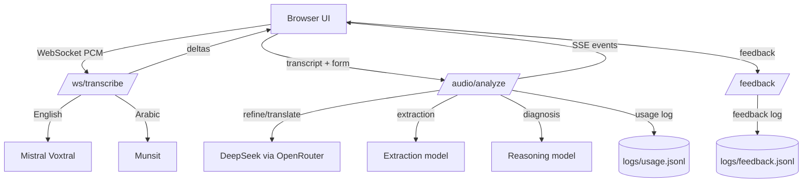
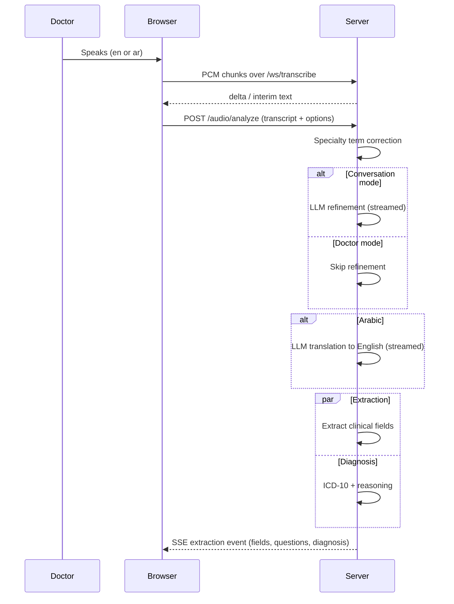

# MedVoice — Project Documentation

MedVoice is a clinical voice assistant that turns a doctor's dictation or a
doctor–patient conversation into a structured clinical note. It transcribes
live audio, refines and translates the transcript, extracts structured
clinical fields, recommends ICD-10 diagnoses with reasoning, and streams every
step to the browser in real time.

---

## Table of Contents

1. [Architecture Overview](#architecture-overview)
2. [Pipeline](#pipeline)
3. [Project Structure](#project-structure)
4. [Configuration](#configuration)
5. [Installation and Running](#installation-and-running)
6. [API Reference](#api-reference)
7. [WebSocket Transcription Protocol](#websocket-transcription-protocol)
8. [SSE Event Reference](#sse-event-reference)
9. [Model Registry](#model-registry)
10. [LLM Concurrency Runtime](#llm-concurrency-runtime)
11. [Load Testing](#load-testing)
12. [Model Evaluation](#model-evaluation)
13. [Testing](#testing)
14. [Logging and Dashboard](#logging-and-dashboard)
15. [Security Notes](#security-notes)

---

## Architecture Overview



Key design points:

- **One FastAPI application** (`src/app.py`) serves the UI, the REST API,
  the WebSocket transcription endpoint, and the analytics dashboard.
- **One shared LLM runtime per worker** owns a single `AsyncOpenAI` client,
  one HTTP connection pool, and per-model semaphores. Requests never build
  their own clients.
- **Streaming everywhere**: transcription streams over WebSocket, analysis
  streams over SSE, so the doctor sees results as each step finishes.
- **Extraction and diagnosis run in parallel** with `asyncio.gather`, halving
  the tail latency of the analysis step.

---

## Pipeline



Stages:

1. **Transcription** — English via Mistral Voxtral realtime; Arabic via
   Munsit (dialect-aware, including Khaliji/Gulf).
2. **Refinement** — LLM cleanup of the raw transcript. Skipped in doctor
   mode; streamed in conversation mode.
3. **Translation** — Arabic to English, streamed. Skipped for English.
4. **Extraction** — structured clinical-note fields for the selected
   department (ER, OPD, or Dental).
5. **Diagnosis** — ICD-10 recommendations, final diagnosis, and reasoning,
   optionally informed by patient history.
6. **Questions** — generated deterministically from the extracted fields.

---

## Project Structure

```
MedVoice/
├── src/
│   ├── app.py                    # FastAPI entrypoint: REST + WebSocket + SSE
│   ├── core/
│   │   ├── config.py             # Environment-backed configuration
│   │   └── model_registry.py     # Model slugs, defaults, judge selection
│   ├── llm/
│   │   ├── runtime.py            # Shared AsyncOpenAI runtime
│   │   ├── limiter.py            # Per-model asyncio semaphores
│   │   └── retry.py              # Bounded retry policy (429/5xx/timeouts)
│   ├── model/
│   │   ├── speech_service.py     # Voxtral + Munsit streaming transcription
│   │   ├── llm_service.py        # Refine/translate/extract/diagnose calls
│   │   ├── refine_text.py        # Synchronous refinement module
│   │   ├── translation.py       # Synchronous translation module
│   │   ├── extract_features.py   # Synchronous extraction module
│   │   ├── diagnosis.py          # Diagnosis helpers
│   │   ├── question_generator.py # Deterministic follow-up questions
│   │   ├── patient_history.py    # HCMS visit-history lookup
│   │   └── specialty_terms.py    # Fuzzy specialty-term correction
│   ├── utils/
│   │   ├── clinical_prompts.py   # Extraction/diagnosis prompts
│   │   ├── prompt.py             # Refine/translate prompts
│   │   └── metrics.py            # Metrics helpers
│   ├── static/                   # index.html + dashboard.html
│   ├── data/                     # Workbooks and visit-history CSV
│   ├── logs/                     # usage.jsonl + feedback.jsonl
│   └── uploads/                  # Uploaded recordings
├── tests/
│   ├── test_concurrency.py       # Deterministic concurrency suite
│   └── test_real_use_case_models.py # Live model evaluation + judge scoring
├── locustfile.py                 # /audio/analyze load test
├── locustfile_transcription.py   # /ws/transcribe load test
├── step_load_shape.py            # Optional stepped load shape
├── requirements-loadtest.txt     # Locust + websocket-client
├── docs/
│   ├── PROJECT_DOCUMENTATION.md  # This file
│   └── llm_concurrency_README.md # LLM runtime configuration
├── Dockerfile
├── docker-compose.yml
├── pyproject.toml
└── setup.py
```

---

## Configuration

All configuration is environment-driven via `src/core/config.py`
(`.env` is loaded automatically).
Docker Compose passes variables from `src/.env` into the container.

### Provider keys

| Variable | Purpose |
|---|---|
| `MISTRAL_API_KEY` | Voxtral English transcription |
| `MUNSIT_API_KEY` | Arabic transcription + TTS disclaimer |
| `OPENROUTER_API_KEY` | Primary OpenRouter key for all LLM steps |
| `OPENROUTER_API_KEYS` | Optional comma-separated keys; first is used by default and later keys are tried after credit-related failures |
| `LLM_API_KEY` | Optional explicit OpenRouter key override; otherwise the singular key or first plural key is used |

### LLM runtime

| Variable | Default | Purpose |
|---|---|---|
| `LLM_BASE_URL` | `https://openrouter.ai/api/v1` | OpenAI-compatible base URL |
| `LLM_TIMEOUT_S` | `45` | Overall request timeout |
| `LLM_CONNECT_TIMEOUT_S` | `5` | Connect timeout |
| `LLM_MAX_ATTEMPTS` | `4` | Retry attempts including the first |
| `LLM_BACKOFF_MAX_S` | `8` | Maximum exponential backoff |
| `LLM_RETRY_AFTER_MAX_S` | `30` | Maximum honored `Retry-After` |
| `LLM_LIMIT_DEFAULT` | `8` | Default per-model concurrency slots |
| `LLM_LIMIT__<MODEL>` | — | Per-model override (non-alphanumerics → `_`) |
| `LLM_MAX_CONNECTIONS` | `100` | HTTP pool maximum |
| `LLM_MAX_KEEPALIVE_CONNECTIONS` | `20` | Keep-alive pool maximum |

### Application

| Variable | Purpose |
|---|---|
| `UPLOAD_FOLDER` | Upload storage location |
| `PATIENT_HISTORY_CSV_PATH` | Visit-history CSV fallback |
| `DASHBOARD_USERNAME` / `DASHBOARD_PASSWORD` | Dashboard HTTP Basic Auth |
| `PATIENT_DB_UID` / `PATIENT_DB_PWD` | HCMS SQL Server credentials |
| `PATIENT_DB_DRIVER` | ODBC driver name |

### Model slugs

Every model slug can be overridden without code changes, e.g.
`MODEL_SLUG_GPT_4O_MINI`, `MODEL_SLUG_SONNET_55`,
`JUDGE_SLUG_FOR_OPENAI`, `JUDGE_SLUG_FOR_NON_OPENAI`.

---

## Installation and Running

### Local

```bash
python -m venv .venv
source .venv/bin/activate
pip install -r src/requirements.txt
cd src
python app.py
```

The application listens on `http://0.0.0.0:7777`.

### Docker

```bash
docker compose up --build
```

`docker-compose.yml` publishes host port `9999`. The application itself
listens on `7777`, so either change the mapping to `9999:7777` or adjust
`uvicorn.run` in `src/app.py` before deploying.

---

## API Reference

Interactive docs are served by FastAPI at `/docs`.

| Method | Path | Purpose |
|---|---|---|
| GET | `/` | Web UI |
| GET | `/models` | Selectable models per pipeline step |
| POST | `/audio/analyze` | Full analysis pipeline (SSE) |
| POST | `/audio/refine-field` | Refine one spoken field answer |
| GET | `/audio/tts-disclaimer` | Recording-consent WAV (Munsit TTS) |
| WS | `/ws/transcribe` | Live transcription |
| GET | `/patient/{code}/history` | Visit history per business unit |
| POST | `/feedback` | Thumbs rating and free-text feedback |
| GET | `/admin/usage` | Recent usage entries |
| GET | `/admin/feedback` | Recent feedback entries |
| GET | `/dashboard` | Analytics dashboard |

### `POST /audio/analyze`

`Content-Type: multipart/form-data`

| Field | Required | Default | Description |
|---|---|---|---|
| `text` | ✅ | — | Transcript (possibly edited by the doctor) |
| `language` | | `en` | `en` or `ar` |
| `mode` | | `doctor` | `doctor` or `conversation` |
| `department` | | `opd` | `er`, `opd`, or `dental` |
| `specialty` | | — | Medical specialty for term correction |
| `use_history` | | `false` | Include patient history in diagnosis |
| `patient_id` | | — | Required when `use_history=true` |
| `business_unit` | | — | `AHJ`, `AMH`, or `ANC`; required with history |
| `extraction_model` | | default | Model id from `GET /models` |
| `reasoning_model` | | default | Model id from `GET /models` |
| `session_id` | | — | Joins feedback to this analysis |

Example:

```bash
curl -N -X POST http://localhost:7777/audio/analyze \
  -F "text=Patient reports chest pain for two hours." \
  -F "language=en" \
  -F "mode=doctor" \
  -F "department=er"
```

---

## WebSocket Transcription Protocol

Endpoint: `ws://localhost:7777/ws/transcribe`

Client → server:

1. Text message: `{"sampleRate": 16000, "language": "en"|"ar", "hotwords": "..."}`
2. Binary messages: float32 little-endian mono PCM chunks.
3. Final text message: `{"cmd": "done"}`

Server → client:

```json
{"type": "delta",   "text": "..."}
{"type": "interim", "text": "..."}
{"type": "done"}
{"type": "error",   "detail": "..."}
```

English routes to Voxtral; Arabic routes to Munsit. Munsit sessions are kept
alive through pauses by an 8-second KeepAlive loop on the server side.

---

## SSE Event Reference

`POST /audio/analyze` streams these events:

| Event | When | Payload highlights |
|---|---|---|
| `refinement_skipped` | Doctor mode | `refined_text` |
| `refinement_delta` | Conversation mode | partial refined text |
| `refinement_done` | Refinement complete | `refined_text`, `refinement_sec` |
| `translation_delta` | Arabic only | partial English text |
| `translation_done` | Translation complete | `final_text`, `translation_sec` |
| `extraction` | Final combined result | fields, questions, diagnosis, usage |
| `error` | Any step failed | `step`, `detail` |

The `extraction` event is emitted after extraction **and** diagnosis finish
(they run in parallel) and contains the complete clinical note payload.

---

## Model Registry

`src/core/model_registry.py` is the single source of truth for model ids,
labels, and OpenRouter slugs.

**Extraction models:** `gpt-4o-mini`, `gpt-5.6-luna`, `glm-5.3-flash`,
`claude-sonnet-5.5`.

**Reasoning models:** `gpt-4o-mini`, `gemini-3.7-flash`,
`claude-sonnet-5.5`, `claude-opus-5`.

Defaults for both steps: `gpt-4o-mini`.

**Judges** (used by the evaluation suite, cross-family by design):

- OpenAI candidates → Claude Opus 5.5
- All other candidates → GPT 5.6 Sol

---

## LLM Concurrency Runtime

See `docs/llm_concurrency_README.md` for the full reference. Summary:

- One `AsyncOpenAI` client per worker, created in the FastAPI lifespan.
- Per-model `asyncio` semaphores (`LLM_LIMIT_DEFAULT`, per-model overrides).
- Bounded retries for 429, 5xx, and timeouts with jitter and `Retry-After`.
- `insufficient_quota` is surfaced without retry or key rotation.
- Streaming holds its slot until the stream ends; retries only before the
  first chunk is emitted.
- Limits are process-local; size them with Little's law
  (`in_flight ≈ calls/s × latency`).

---

## Load Testing

Install the load-test dependencies separately:

```bash
pip install -r requirements-loadtest.txt
```

### Analysis pipeline (`POST /audio/analyze`)

```bash
locust -f locustfile.py --host http://localhost:7777
locust -f locustfile.py --host http://localhost:7777 \
  --headless -u 30 -r 8 -t 5m --csv results --html report.html
```

Key variables: `LOCUST_LANGUAGE_MIX` (default `en:70,ar:30`),
`LOCUST_MODE_MIX` (default `doctor:70,conversation:30`),
`LOCUST_LENGTH_MIX` (default `short:50,medium:35,long:15`),
`LOCUST_MAX_FAIL_RATIO` (default `0.01`), `LOCUST_MAX_P95_MS`.

The main row measures the **complete SSE stream**; additional rows record
`SSE first event`, `SSE final extraction`, and per-stage timings.

### Live transcription (`/ws/transcribe`)

```bash
locust -f locustfile_transcription.py --host http://localhost:7777 \
  --headless -u 10 -r 2 -t 2m
```

- Default audio is a synthetic tone (no speech, no PHI). Use
  `LOCUST_REQUIRE_RESULT=false` for connection-capacity runs.
- For speech runs, convert approved audio first:

  ```bash
  ffmpeg -i recording.mp3 -ar 16000 -ac 1 -f f32le recording.pcm
  ```

  then set `LOCUST_PCM_FILE=recording.pcm` and keep
  `LOCUST_REQUIRE_RESULT=true`.

- `LOCUST_TRANSCRIPTION_LANGUAGE=en` tests Voxtral only; `ar` tests Munsit
  only; the mix variable splits traffic between them.

### Stepped load shape

```bash
locust -f locustfile.py,step_load_shape.py --host http://localhost:7777
```

Defaults: 10 → 20 → 40 → 60 → 80 → 100 users, two minutes per step.
Configure with `LOCUST_SHAPE_STEPS`, `LOCUST_SHAPE_STEP_SECONDS`,
`LOCUST_SHAPE_SPAWN_RATE`.

---

## Model Evaluation

The live evaluation suite sends the six workbook scenarios (ER, OPD, Dental)
through every extraction and reasoning model, then grades each output with a
cross-family judge and writes an Excel report.

```bash
RUN_REAL_USE_CASE_EVAL=1 \
PYTHONPATH=src \
.venv/bin/python -m pytest tests/test_real_use_case_models.py -s
```

Useful variables:

| Variable | Purpose |
|---|---|
| `REAL_USE_CASE_XLSX` | Input workbook path |
| `REAL_USE_CASE_REPORT` | Output XLSX path |
| `REAL_USE_CASE_SCENARIO` | e.g. `ER-1` or `ER-1,OPD-1` to evaluate a subset |
| `REAL_USE_CASE_FAIL_ON_ERROR` | Fail pytest on any model error |
| `JUDGE_SLUG_FOR_OPENAI` | Judge for OpenAI candidates |
| `JUDGE_SLUG_FOR_NON_OPENAI` | Judge for all other candidates |

The report contains per-field `Score (0-100)`, `Justification`, and
`Judge Model` columns, plus a summary sheet with average scores.

---

## Testing

Deterministic concurrency suite (no live providers):

```bash
PYTHONPATH=src .venv/bin/python -m pytest -k concurrency -q
```

Live model evaluation (opt-in, costs money):

```bash
RUN_REAL_USE_CASE_EVAL=1 PYTHONPATH=src \
.venv/bin/python -m pytest tests/test_real_use_case_models.py -s
```

---

## Logging and Dashboard

- `src/logs/usage.jsonl` — one entry per analysis session (append-only).
- `src/logs/feedback.jsonl` — doctor feedback entries.
- `/dashboard` — client-side aggregation of both logs.
- `/admin/usage` and `/admin/feedback` — raw JSON endpoints.

Set `DASHBOARD_USERNAME` and `DASHBOARD_PASSWORD` before exposing the
dashboard outside a trusted network; usage logs contain transcripts.

---

## Security Notes

- Provider keys live only in environment variables; the runtime never logs
  keys, prompts, response bodies, or PHI.
- The dashboard is protected by HTTP Basic Auth **only when both credentials
  are set**.
- Patient-history lookups require `patient_id` and `business_unit` and use
  configured SQL Server credentials.
- Load tests use synthetic data only; never point them at real patient
  recordings.
