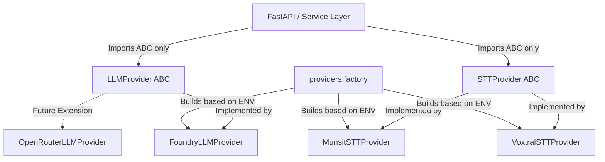

# M2.1: Provider Abstraction Layer — Architecture & Protocol Contracts

## 1. Architectural Motivation & Problem Statement
Historically, MedVoice components (e.g. `LLMService`, `SpeechService`, `app.py`) directly interacted with concrete SDKs and hardcoded API endpoints:
- Azure OpenAI / Azure AI Foundry SDK clients (`AsyncOpenAI`) were directly invoked inside `llm_service.py`.
- Live WebSocket audio streaming was coupled to specific endpoints (`MUNSIT_WS_URL`, `Mistral/Voxtral`).
- Testing required intricate monkeypatching of deep network calls and connection handles.
- Supporting multi-cloud or alternative inference backends (such as OpenRouter, on-prem Whisper, or private LLM instances) was impossible without rewriting business logic.

The **M2 Provider Abstraction Layer** decouples clinical orchestration from concrete vendor APIs through Python Abstract Base Classes (ABCs), establishing strict type contracts, lifecycles, and health probing semantics.



---

## 2. Package Organization & Public Interface

All provider modules live under `src/providers/`:
```
src/providers/
├── __init__.py          # Single public export surface with lazy factory loader
├── base.py              # Protocol contracts: LLMProvider, STTProvider, ProviderHealthResult
├── factory.py           # Provider registry, singleton resolution, and env switches
├── foundry_llm.py       # Azure AI Foundry concrete LLM adapter
├── munsit_stt.py        # Munsit concrete STT adapter (Arabic & code-switching)
└── voxtral_stt.py       # Voxtral concrete STT adapter (English realtime)
```

> [!IMPORTANT]
> **Developer Golden Rule:** Application code (e.g., pipeline steps, HTTP routes, agents) **MUST NEVER** import from `providers.foundry_llm`, `providers.munsit_stt`, or `providers.voxtral_stt` directly. Always import from `providers` or resolve instances via `get_llm()` / `get_stt()` / `request.app.state.llm_provider`.

---

## 3. Protocol Contracts (`src/providers/base.py`)

### 3.1 `ProviderHealthResult` Value Object
An immutable, frozen dataclass used for reporting provider availability to `/health` and telemetry:

```python
@dataclass(frozen=True)
class ProviderHealthResult:
    ok: bool
    latency_ms: Optional[float] = None
    provider: str = "unknown"
    detail: Optional[str] = None
    checked_at: float = field(default_factory=time.monotonic)

    @classmethod
    def healthy(cls, provider: str, latency_ms: float) -> "ProviderHealthResult": ...

    @classmethod
    def unhealthy(cls, provider: str, detail: str, latency_ms: Optional[float] = None) -> "ProviderHealthResult": ...

    def to_dict(self) -> Dict[str, Any]: ...
```

#### Key Technical Notes:
1. **Immutability (`frozen=True`)**: Prevents race conditions or unintended mutations when health results are shared across async monitoring routines.
2. **`checked_at`**: Uses `time.monotonic()` for precision interval tracking independent of system clock drifts.
3. **No PHI**: The `detail` field must never include patient identifiers or clinical transcript fragments.

---

### 3.2 `LLMProvider` Abstract Base Class
Defines the uniform interface for non-streaming completions, unbuffered token streaming, resource teardown, and health probes.

```python
class LLMProvider(ABC):
    @abstractmethod
    async def complete(
        self,
        *,
        model: str,
        messages: List[Dict[str, Any]],
        max_tokens: int,
        response_format: Optional[Dict[str, Any]] = None,
        reasoning_effort: Optional[str] = None,
    ) -> Any:
        """Non-streaming chat completion returning raw response object."""

    @abstractmethod
    def stream(
        self,
        *,
        model: str,
        messages: List[Dict[str, Any]],
        max_tokens: int,
        response_format: Optional[Dict[str, Any]] = None,
    ) -> AsyncIterator[str]:
        """Async generator yielding text delta strings as they arrive."""

    @abstractmethod
    async def close(self) -> None:
        """Gracefully release connection pools and underlying clients."""

    @abstractmethod
    async def health_check(self) -> ProviderHealthResult:
        """Lightweight reachability probe. Must never raise."""
```

#### Contract Guarantees:
- **Concurrency Contract**: All implementations must be safe for concurrent execution across hundreds of asyncio tasks. Clients must never be instantiated per-call.
- **SSE Streaming Support**: `stream()` returns an `AsyncIterator[str]`. Implementations must yield deltas progressively without internal token accumulation.
- **Safe Teardown**: `close()` is idempotent and called during FastAPI lifespan shutdown.

---

### 3.3 `STTProvider` Abstract Base Class
Defines the uniform interface for batch file transcription and bidirectional live streaming.

```python
class STTProvider(ABC):
    @abstractmethod
    async def transcribe_file(
        self,
        audio_path: str,
        language: str,
    ) -> str:
        """Transcribe pre-recorded audio file to text."""

    @abstractmethod
    def transcribe_live_ar(
        self,
        audio_stream: AsyncIterator[bytes],
    ) -> AsyncIterator[str]:
        """Stream Arabic/code-switching audio bytes to text deltas."""

    @abstractmethod
    def transcribe_live_en(
        self,
        audio_stream: AsyncIterator[bytes],
    ) -> AsyncIterator[str]:
        """Stream English audio bytes to text deltas."""

    @abstractmethod
    async def health_check(self) -> ProviderHealthResult:
        """Lightweight endpoint probe. Must never raise."""
```

#### Contract Guarantees:
- **Audio Format Invariance**: Audio bytes received by `transcribe_live_*` are normalized to `pcm_s16le` at 16 kHz mono by the audio ingestion pipe before reaching this interface.
- **Provider Switching**: Clinical workflows dictate engine selection (Munsit for dialectal Arabic / code-switching; Voxtral for high-accuracy English dictation).
