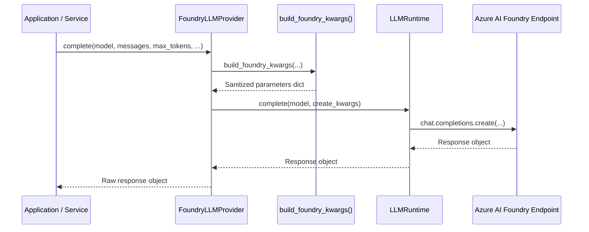

# M2.2: Concrete Provider Adapters Implementation

This document details the internal design and mechanics of concrete provider adapters: `FoundryLLMProvider`, `MunsitSTTProvider`, and `VoxtralSTTProvider`.

---

## 1. `FoundryLLMProvider` (`src/providers/foundry_llm.py`)

### Purpose
Wraps Azure AI Foundry's deployment infrastructure (`AsyncOpenAI` pointed at Azure cognitive endpoints) behind the `LLMProvider` protocol without modifying existing retry logic, jitter backoff, or per-model concurrency limits.

### Architecture & Delegation Flow

### Critical Implementation Details
1. **Zero Argument Duplication**:
   - Azure AI Foundry has specific parameter nuances depending on the deployment (e.g. `gpt-5.6-luna`, `DeepSeek-V3.2`).
   - `FoundryLLMProvider` delegates argument translation directly to `src/llm/provider.py::build_foundry_kwargs()`. It handles model profile lookups, omission of unsupported parameters (e.g., `temperature=0` on reasoning models), and fallback from strict schema to standard JSON object.
2. **Streaming Execution**:
   - In `stream()`, it invokes `build_foundry_kwargs(..., stream=True)` and iterates directly through `self._runtime.stream(model=model, create_kwargs=kwargs)`. Chunks are yielded on the fly to prevent buffer bloat.
3. **Health Check Probing**:
   - Probes the Azure AI Foundry endpoint using `self._runtime.client.models.list()`.
   - Uses an internal timeout of 5.0 seconds.
   - Measures network round-trip with monotonic timing.
   - Converts exceptions to `ProviderHealthResult.unhealthy(...)`, ensuring calls to health checks never trigger unhandled HTTP 500 errors.

---

## 2. `MunsitSTTProvider` (`src/providers/munsit_stt.py`)

### Purpose
Acts as the primary adapter for Arabic clinical dictation and Arabic-English code-switching speech streams.

### Architecture & Delegation Flow
1. **Arabic Live Streaming (`transcribe_live_ar`)**:
   - Delegates directly to `SpeechService.transcribe_live_stream_ar`.
   - Consumes live WebSocket bytes (`raw_pcm_iter`), coordinates FFmpeg audio resampling to 16 kHz linear PCM, sends keepalives to prevent idle disconnection, and yields committed final transcript segments.
2. **Batch File Transcription (`transcribe_file`)**:
   - Delegates to `SpeechService.transcribe_audio(audio_path, language=language)`.
3. **Endpoint Health Probing (`health_check`)**:
   - Sends an HTTP GET probe to `https://api.munsit.com/api/v1/voices` using an asynchronous `httpx.AsyncClient(timeout=5.0)`.
   - Accepts status code 200 (or authentication responses 401/403) as confirmation of network reachability.

---

## 3. `VoxtralSTTProvider` (`src/providers/voxtral_stt.py`)

### Purpose
Acts as the adapter for English clinical dictation and post-recording audio files via Voxtral / Mistral Realtime WebSocket streaming.

### Architecture & Delegation Flow
1. **English Live Streaming (`transcribe_live_en`)**:
   - Delegates directly to `SpeechService.transcribe_live_stream`.
   - Yields token delta strings in real time as speech is recognized.
2. **Batch File Transcription (`transcribe_file`)**:
   - Delegates to `SpeechService.transcribe_audio(audio_file_path=audio_path, language="en")`.
3. **Endpoint Health Probing (`health_check`)**:
   - Probes `https://api.mistral.ai/v1/models` using `httpx.AsyncClient` with bearer token authentication.
   - Returns latency in milliseconds and reports status as `healthy` or `unhealthy`.

---

## 4. Key Notes for Adding Future Providers

When adding a new provider adapter (e.g., `OpenRouterLLMProvider` or `LocalWhisperSTTProvider`):
1. Inherit from `LLMProvider` or `STTProvider` from `providers.base`.
2. Implement **all** abstract methods (`complete`, `stream`, `close`, `health_check` or `transcribe_*`).
3. Ensure the class name follows the convention `<Name>LLMProvider` or `<Name>STTProvider` (the `provider_name` property automatically extracts the lowercase prefix).
4. Register the new class in `src/providers/factory.py`.
