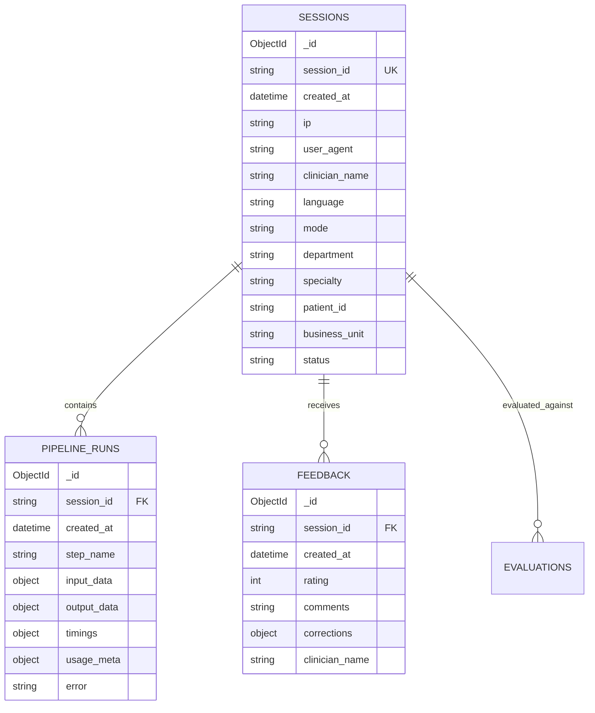

# MongoDB Session Persistence & Document Design

## 1. Motivation: From JSONL to MongoDB
MedVoice originally stored session runs inside append-only JSONL files (`logs/usage.jsonl`). While simple, this had significant limitations:
- **No Queryability**: Querying sessions by clinician, department, date range, or patient required scanning and deserializing entire log files.
- **Disconnected Data**: Input audio/transcripts were not linked to intermediate LLM pipeline steps or clinician feedback.
- **Concurrency Bottlenecks**: Concurrent file writes risked data interleaving or file descriptor contention.

MedVoice utilizes **MongoDB** via `motor` (asynchronous MongoDB driver for asyncio) with a dedicated repository pattern and write-behind buffering.

---

## 2. Document Schema Design



---

## 3. High-Performance Indexing Strategy

To maintain sub-millisecond query execution on busy dashboard and analytics queries, indexes are built asynchronously upon database connection in `src/db/connection.py`:

```python
# sessions collection
db.sessions.create_index([("session_id", 1)], unique=True)
db.sessions.create_index([("created_at", -1)])
db.sessions.create_index([("department", 1), ("created_at", -1)])
db.sessions.create_index([("patient_id", 1)])
db.sessions.create_index([("clinician_name", 1)])

# pipeline_runs collection
db.pipeline_runs.create_index([("session_id", 1)])
db.pipeline_runs.create_index([("step_name", 1), ("created_at", -1)])

# feedback collection
db.feedback.create_index([("session_id", 1)])
db.feedback.create_index([("created_at", -1)])
```

---

## 4. Write-Behind Buffering (`SessionRepository`)

Under heavy clinical peak loads (e.g. 50+ concurrent live dictation sessions), writing every intermediate token or minor step update synchronously to MongoDB can saturate network I/O.

### Write-Behind Buffer Mechanics:
1. When `buffer_write=True` is passed to repository write calls, documents are placed into an in-memory queue (`asyncio.Queue` / memory list).
2. A background worker task flushes buffered documents in batches every **N documents (e.g. 20)** or every **T seconds (e.g. 1.0s)** using MongoDB's `insert_many(..., ordered=False)`.
3. If MongoDB is unavailable or times out, the repository logs a warning and automatically falls back to appending structured events to `logs/usage.jsonl` so no clinical session data is lost.
