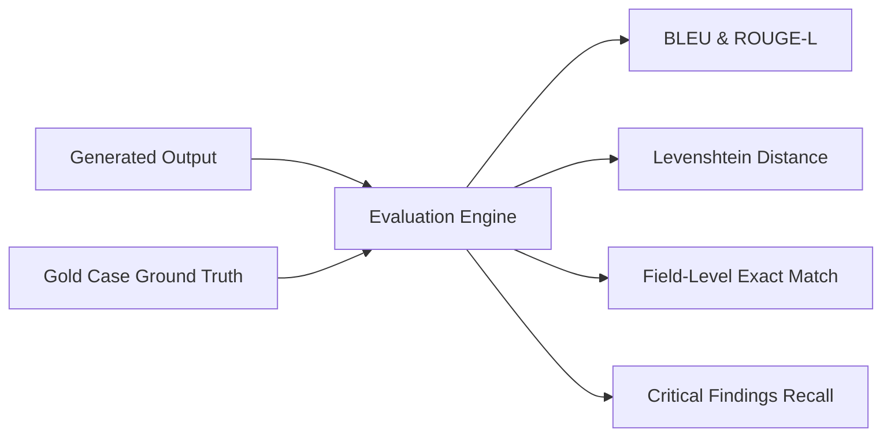

# Gold Dataset Store & Automated Evaluation Engine

## 1. Overview & Evaluation Goals
The **Gold Dataset Store & Evaluation Engine** ensures clinical AI safety and extraction quality. It enables data science and clinical informatics teams to:
1. Maintain curated, ground-truth clinical encounters across specialties (ER, OPD, Dental) and languages (Arabic, English).
2. Automatically benchmark candidate LLM models, prompts, or provider backends (e.g., Azure AI Foundry vs. OpenRouter).
3. Compute standardized NLP and clinical extraction metrics without manual chart review.

---

## 2. Gold Case Schema (`src/schemas/gold_schemas.py`)

A ground-truth clinical case is represented by the `GoldCase` Pydantic model:

```python
class GoldCase(BaseModel):
    case_id: str = Field(..., description="Unique ID, e.g. 'ER-001'")
    department: str = Field(..., pattern=r"^(er|opd|dental)$")
    specialty: Optional[str] = None
    audio_language: str = Field("ar", pattern=r"^(ar|en)$")
    # Ground truth input
    transcript: str = Field(..., min_length=10)
    # Expected output
    expected_soap: Optional[Dict[str, Any]] = None
    expected_fields: Dict[str, Any] = Field(..., description="Key clinical facts that must be extracted")
    critical_findings: List[str] = Field(default_factory=list, description="Must-not-miss clinical red flags")
    metadata: Dict[str, Any] = Field(default_factory=dict)
```

---

## 3. Clinical Metrics Suite (`src/evaluation/metrics.py`)

The evaluation runner computes multi-dimensional scores across generated outputs:



### Metrics Definitions:
1. **Field-Level Accuracy**: Percentage of expected key-value clinical fields (e.g., dosage, duration, chief complaint) correctly identified in the extraction.
2. **Critical Findings Recall**: A safety-critical metric measuring whether high-stakes red flags (e.g., "chest pain radiating to jaw", "anaphylaxis history") were omitted by the model.
3. **ROUGE-L & BLEU**: Standardized n-gram overlap between generated clinical narrative summaries and ground-truth doctor notes.
4. **Levenshtein Similarity**: Character/token edit distance for normalization and spelling consistency across Arabic medical dialects.

---

## 4. Evaluation CLI Harness (`scripts/run_eval.py`)

Data scientists can trigger automated evaluation runs across candidate configurations:

```bash
# Run evaluation across all gold cases using Foundry
python scripts/run_eval.py --department er --model gpt-5.6-luna

# Compare models side-by-side
python scripts/run_eval.py --compare gpt-4o,gpt-5.6-luna --output eval_report.json
```

Evaluation runs and aggregate scores are persisted to the `evaluations` collection in MongoDB, providing longitudinal tracking across model deployment versions.
